<picture>
  <source media="(prefers-color-scheme: dark)" srcset="assets/signal-hero-dark.svg">
  <source media="(prefers-color-scheme: light)" srcset="assets/signal-hero-light.svg">
  
</picture>

I build web apps and developer tools, and contribute fixes, tests and documentation to open source. My recent work explores distributed tracing, code change analysis and reproducible evaluation.

**Working with:** Python · TypeScript · JavaScript · SQL · React · FastAPI · Testing · CI

[Projects](#from-the-workbench) · [Merged contributions](#contributions-that-landed) · [Open pull requests](#in-review) · [All repositories](https://github.com/LuciferAksh?tab=repositories)

<picture>
  <source media="(prefers-color-scheme: dark)" srcset="assets/build-trail-dark.svg">
  <source media="(prefers-color-scheme: light)" srcset="assets/build-trail-light.svg">
  
</picture>

## From the workbench

<picture>
  <source media="(prefers-color-scheme: dark)" srcset="assets/workbench-dark.svg">
  <source media="(prefers-color-scheme: light)" srcset="assets/workbench-light.svg">
  
</picture>

### [IncidentLab](https://github.com/LuciferAksh/incidentlab)

A local distributed-systems lab with independent HTTP services, OpenTelemetry traces and controlled fault injection. The React dashboard connects service dependencies, incident evidence and trace waterfalls so a diagnosis can be inspected.

**Python · FastAPI · React · OpenTelemetry · SQLite**

### RepoLens

Trace a Git change through TypeScript compiler references to potentially affected modules and tests. Includes a CLI, an interactive dependency graph, baseline/working source views and explainable paths. Recommendations support review; they do not replace the test suite.

**TypeScript · Compiler API · CLI · React** · Local build; public repository link coming after publication.

### [SkillCheck](https://github.com/LuciferAksh/skillcheck)

Compare skill versions on the same coding challenge with deterministic acceptance checks, recorded hashes and inspectable HTML reports. Fixture demonstrations stay separate from model evaluations.

**Node.js · Evaluation tooling · Reproducibility**

### More projects

| Project | What it does |
| :--- | :--- |
| **Practical Agent Skills** | **CSV Import Preflight:** identify import blockers while preserving IDs, with a cell-level change log. **Client Scope Ledger:** compare requests with an agreed brief and link decisions to evidence. Two packaged skills; not yet published. |
| **[Gather](https://github.com/LuciferAksh/Even-Planner)** | Event planning, budgets and collaboration in a TypeScript app. |
| **[LegalLens](https://github.com/LuciferAksh/legallens-ai)** | A TypeScript prototype for AI-assisted document exploration. |
| **[SEVA](https://github.com/LuciferAksh/seva-platform)** | A disaster-relief coordination prototype with a Python backend. |

## Contributions that landed

| Project | Contribution | Pull request |
| :--- | :--- | :--- |
| **SQLFluff** | DuckDB `CREATE SECRET` / `DROP SECRET` parsing, native syntax checks and regression fixtures. | [Merged · #9155](https://github.com/sqlfluff/sqlfluff/pull/9155) |
| **GmailCleaner** | Ruff checks in CI, with existing findings resolved in a separate cleanup commit. | [Merged · #24](https://github.com/akadeepesh/GmailCleaner/pull/24) |
| **Rowsetta** | Installed package version in the CLI, with regression coverage. | [Merged · #4](https://github.com/intesarjawad/rowsetta/pull/4) |
| **Sklearn-genetic-opt** | Clarify cross-validation MAE versus held-out test MAE in a beginner recipe. | [Merged · #401](https://github.com/rodrigo-arenas/Sklearn-genetic-opt/pull/401) |

Also accepted: [Rowsetta CSV regression coverage](https://github.com/intesarjawad/rowsetta/commit/9f7f84605ebac37af62f12c50e36d24b7ddb52a6) for CRLF line endings and quoted multiline cells. The credited commit remains in upstream after the repository was recreated.

## In review

| Project | Proposed change | Pull request |
| :--- | :--- | :--- |
| **Claude Agent SDK** | Handle malformed parent IDs in session-history reads. | [Open · #1511](https://github.com/anthropics/claude-agent-sdk-python/pull/1511) |
| **Novela** | Preserve Unicode book titles in export, backup and cover filenames. | [Open · #20](https://github.com/akadeepesh/Novela/pull/20) |
| **Stormfork** | Actionable CLI errors for invalid timestamps. | [Open · #4](https://github.com/intesarjawad/stormfork/pull/4) |

Contribution statuses checked on 16 November 2026. Open PRs are awaiting review or maintainer action.

---

**Build with purpose. Follow the evidence. Keep improving.**

[Explore my repositories](https://github.com/LuciferAksh?tab=repositories)
